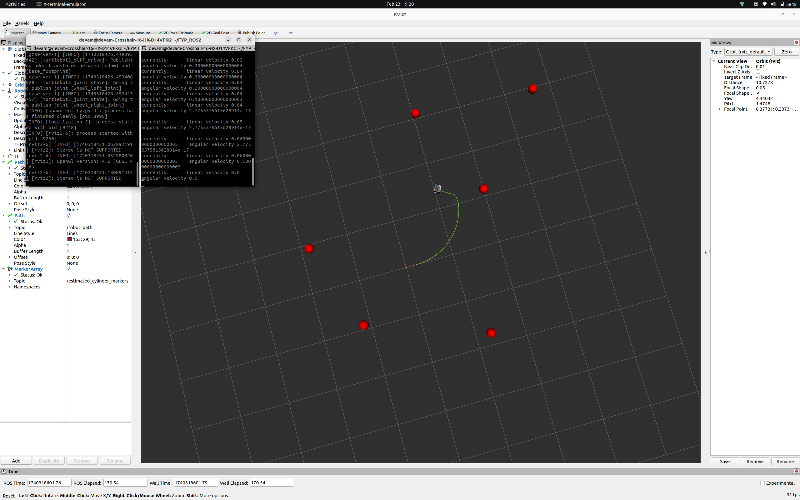

# **EKF Localization and EKF-SLAM for TurtleBot3 (ROS2 Humble)**



This repository implements **Extended Kalman Filter (EKF) localization** for **TurtleBot3** in **ROS2 Humble**, utilizing Gazebo and RViz for simulation and visualization. It also includes an **EKF-SLAM** module that provides the robot’s current pose and covariance, as well as the coordinates of detected features and their covariances.

## **Features**

- **EKF-Based Localization:**  
  - Integrates **odometry and laser scan** data for state estimation.  
  - Publishes estimated pose (`/pose_with_cov_stamped`).  

- **EKF-SLAM Integration:**  
  - Provides the **robot’s current pose and covariance**.  
  - Outputs **coordinates of detected features** along with their covariances.  
  - Uses the **same Gazebo world** as used in localization for testing consistency.

- **Trajectory Visualization:**  
  - EKF-estimated trajectory (`/robot_path`, **red** in RViz).  
  - Raw odometry trajectory the filter is fed (`/real_robot_path`, **green** in RViz). With `odom_topic:=/odom_noisy` this is the *noisy* odometry, not the true pose.  
  - 2σ position uncertainty ellipse (`/error_ellipse`).  

- **Landmark Detection:**  
  - Detects cylinders in the lidar scan and matches them to the known map.  
  - Map landmarks: blue cubes (`/reference_cylinder_markers`, all 17).  
  - Landmarks matched in the latest scan: red spheres (`/estimated_cylinder_markers`), drawn where the lidar saw them from the EKF pose. A sphere sitting on its cube means the estimate is right. Only cylinders within the 3.5 m lidar range and not hidden behind others are shown, so expect a handful at a time.  

- **Self-contained Launch:**  
  - Starts Gazebo with the landmark world and spawns the TurtleBot3 at the origin (where the EKF starts).  
  - The EKF node and RViz start **7 seconds** later, once the simulation is ready.  
  - Map, world and RViz config are installed with the package, so there are no machine-specific paths.

---

## **Installation & Setup**

### **1. Clone the Repository**

Requires ROS 2 Humble, Gazebo Classic and a TurtleBot3 workspace (`turtlebot3`, `turtlebot3_simulations`) at `~/turtlebot3_ws`.

```bash
git clone https://github.com/Devam-032/ekf_localization_ros2.git
```

### **2. Build the Package**

```bash
cd ekf_localization_ros2
source /opt/ros/humble/setup.bash
source ~/turtlebot3_ws/install/setup.bash
colcon build --packages-select ekf_localization
```

### **3. Source the Environment**

```bash
source ~/turtlebot3_ws/install/setup.bash
source install/setup.bash
export TURTLEBOT3_MODEL=burger
```

---

## **Running the Simulation**

To launch the **Gazebo world**, **EKF localization/EKF-SLAM nodes**, and **RViz**, run:

```bash
ros2 launch ekf_localization ekf_localization.launch.py
```

Launch arguments:

| Argument | Default | Meaning |
|---|---|---|
| `gui` | `true` | Start the Gazebo client window |
| `odom_topic` | `/odom` | Odometry the EKF predicts with. Gazebo's `/odom` is perfect, so for a meaningful test use a noisy relay (see [Evaluation](#evaluation)) with `odom_topic:=/odom_noisy` |

> *Note: For running EKF-SLAM, you can execute the corresponding launch file:*

```bash
ros2 launch ekf_slam ekf_slam.launch.py
```


### **Launch Sequence:**  
1. **Gazebo loads the landmark world** and spawns the TurtleBot3 at the origin  
2. `map_reader` / `map_sub` publish the landmark coordinates from the map image  
3. **After 7 seconds** the EKF node starts (it waits for the first `/scan`)  
4. **RViz launches** with the predefined configuration

---

## **Filter Details**

Each 0.5 s cycle:

1. **Predict** with the odometry motion model (rot1, trans, rot2), applied to the previous *filtered* estimate so landmark corrections carry forward.
2. **Detect** cylinders as falling/rising edge pairs in the lidar scan (range, bearing).
3. **Associate** each detection with the nearest predicted map landmark inside a gate of 0.4 m range / 0.25 rad bearing; each landmark is used at most once per scan.
4. **Update** with all matched landmarks in one batch EKF step (range/bearing measurement model, σ_r = 0.1 m, σ_α = 0.035 rad).

---

## **Evaluation**

Because Gazebo's `/odom` is the true pose, the evaluation adds realistic error to it and feeds that to the EKF:

- `tools/ekf_eval/ekf_tools.py noisy_odom`: republishes `/odom` as `/odom_noisy`, integrating the true motion increments with odometry-model Gaussian noise plus a small heading bias (0.012 rad/m), like real wheel odometry.
- `ekf_tools.py drive`: drives a 22 m loop through the landmark field (every leg ≥ 0.7 m from a cylinder).
- `ekf_tools.py log`: records true pose, noisy odometry and the EKF estimate with covariance to CSV.

Results on the 22 m loop (265 EKF updates):

| | Mean position error | Max position error |
|---|---|---|
| Noisy odometry | 0.30 m | 0.70 m |
| **EKF** | **0.043 m** | **0.10 m** |

Reproduce (writes `tools/ekf_eval/out/ekf-paths.csv` and an RViz screenshot):

```bash
./tools/ekf_eval/run.sh 300
```

CSV columns: `t, gt_x, gt_y, gt_yaw, odom_x, odom_y, odom_yaw, ekf_x, ekf_y, ekf_yaw, cov_xx, cov_yy, cov_xy`.

Offline unit check of association + update (no simulator needed):

```bash
python3 tools/ekf_eval/test_update.py
```

---

## **Project Structure**

```
ekf_localization_ros2/
├── tools/ekf_eval/                    # Noisy-odometry relay, loop driver, logger, run.sh
src/
├── ekf_localization/
│   ├── ekf_localization
│   │   ├── __init__.py
│   │   ├── ekf_localization.py        # Main EKF node for localization
│   │   ├── map_reader.py              # Reads the landmark map image
│   │   └── map_sub.py                 # Publishes landmark coordinates
│   ├── maps/                          # Landmark map (map.yaml + image)
│   ├── launch/
│   │   └── ekf_localization.launch.py # Launch file
│   ├── rviz/
│   │   └── default.rviz               # RViz configuration
│   ├── worlds/
│   │   └── fyp_world.world            # Shared Gazebo world
│   ├── package.xml
│   └── setup.py
│
├── ekf_slam/
│   ├── ekf_slam/
│   │   └── ekf_slam_vw.py             # EKF-SLAM implementation
│   ├── package.xml
│   └── setup.py
```

> ✅ The **`ekf_slam`** directory contains a subfolder named `ekf_slam` with the main code file `ekf_slam_vw.py`. It **reuses the same `fyp_world.world` environment** used in localization for consistency in testing.

---

## **Troubleshooting**

### **1. No LaserScan Data Received**  
- The EKF node **waits until valid `/scan` data** is received before proceeding.  
- Ensure Gazebo has fully initialized before launching the EKF node.  

### **2. Workspace Not Sourced**  
- If ROS2 can’t find the package, verify that the correct workspaces are sourced:  

  ```bash
  source ~/turtlebot3_ws/install/setup.bash
  source install/setup.bash
  ```

### **3. RViz Not Showing Expected Visuals**  
- If RViz doesn’t load properly, manually load `default.rviz` via:  

  ```bash
  rviz2 -d src/ekf_localization/rviz/default.rviz
  ```

### **4. Gazebo World Not Launching**  
The world is installed with the package (`share/ekf_localization/worlds/fyp_world.world`); no files need copying into `turtlebot3_gazebo`. If Gazebo fails to start, make sure no old `gzserver` is still running (`pkill gzserver`) and that `~/turtlebot3_ws/install/setup.bash` is sourced so `turtlebot3_gazebo` is found. A warning about the missing `libros2_objectpose_plugin.so` is harmless.

---

## **Contributing**

We welcome contributions! If you have improvements, bug fixes, or new features to add, feel free to submit a pull request. Before contributing, please follow these steps:

1. **Fork the repository**
2. **Create a feature branch**

   ```bash
   git checkout -b feature-branch-name
   ```

3. **Commit changes** with clear messages  
4. **Push to your fork** and submit a pull request  

For major changes, please open an issue to discuss proposed modifications.

---

## **License**

This project is open-source. Please check `LICENSE` for details.

## **Maintainer**

- **Name:** Devam Shah  
- **Email:** devamshah82@gmail.com
